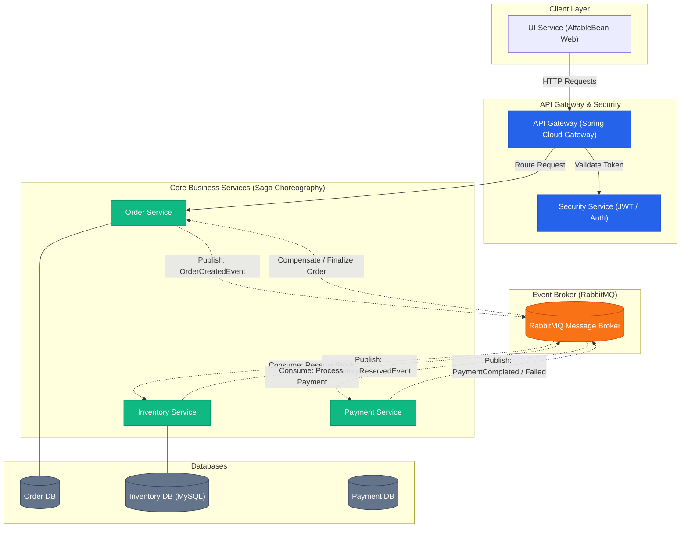

# E-Commerce Microservices Platform (Saga Pattern)

An event-driven distributed e-commerce architecture built with Spring Boot, Spring Cloud Gateway, RabbitMQ, and MySQL.

---

## 🏗 System Architecture

---

## 🛠 Tech Stack & Services

- **API Gateway:** Spring Cloud Gateway (Routing & Rate Limiting)
- **Security Service:** Spring Security, JWT (Authentication & Authorization)
- **Order Service:** Spring Boot, JPA/Hibernate, MySQL
- **Inventory Service:** Spring Boot, Inventory Management, MySQL
- **Payment Service:** Spring Boot, Transaction Handling
- **UI Service:** Spring Boot, Web UI
- **Message Broker:** RabbitMQ (Event-driven asynchronous communication)